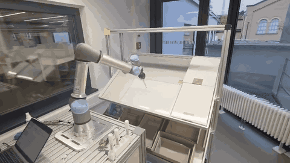
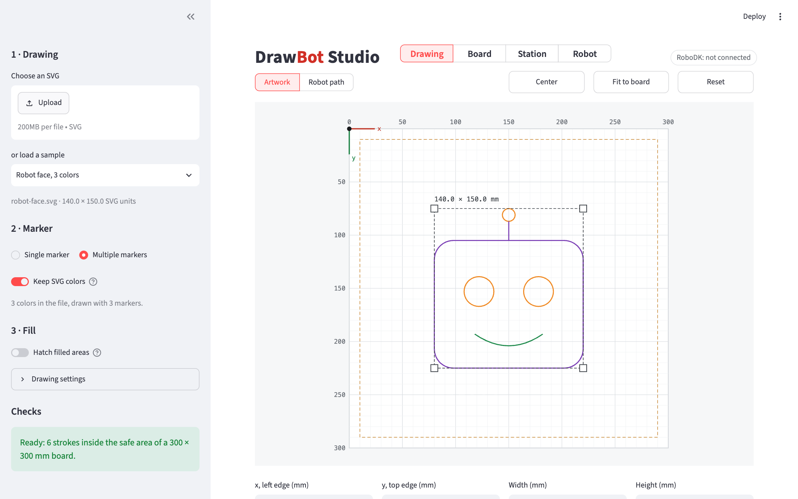
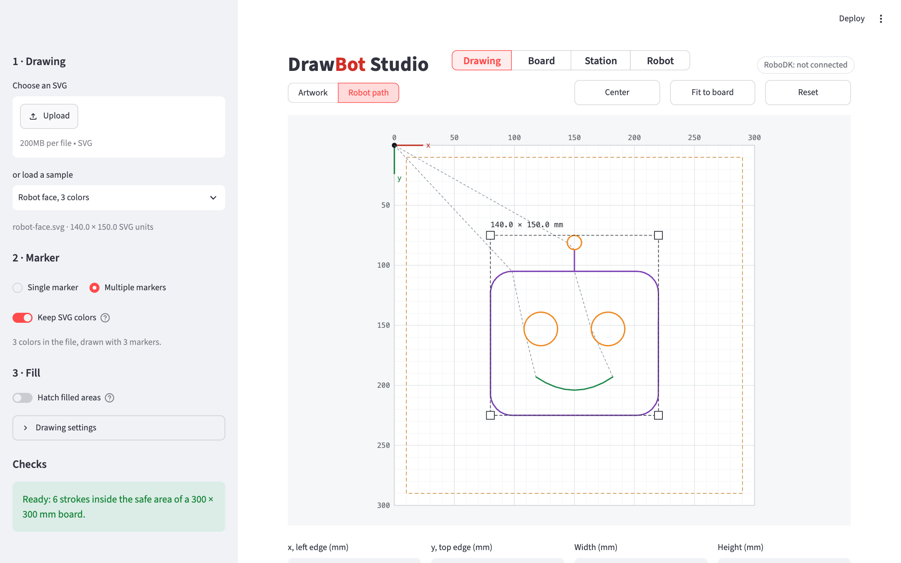
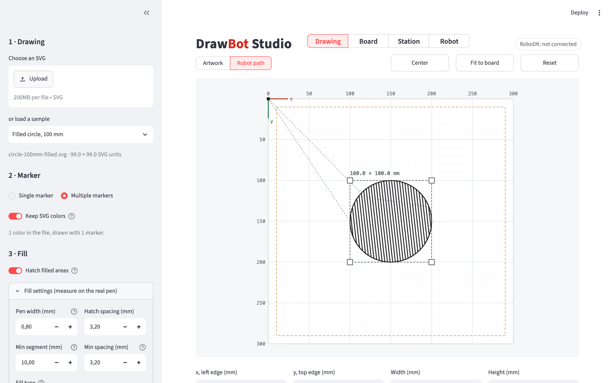

# DrawBot

Draw any SVG on a whiteboard with a Universal Robots UR5e. Upload a drawing in a web app, place it on the measured
board, and the robot draws it with markers: one colour or several, outlines or filled areas.



*A UR5e drawing a multi-colour SVG, changing markers by itself (15x speed).*

**Contents:** [What it does](#what-it-does) · [How it works](#how-it-works) · [Hardware](#hardware) · [Quick start](#quick-start) · [Drawing on the robot](#drawing-on-the-robot) · [Troubleshooting](#troubleshooting) · [Project structure](#project-structure)

## What it does

- **SVG to robot paths.** Paths, circles, rectangles, polygons and nested transforms are turned into strokes in
  board millimetres. Curves are sampled and simplified to within 0.2 mm, well under a marker's line width.
- **Place it on the board.** Drag to move, drag a corner to scale (aspect ratio locked), or type the position in mm.
- **Colours.** Every SVG colour is matched to one of four markers by hue, or chosen by hand per stroke.
- **Fill.** Filled shapes can be hatched with parallel lines or contour rings, spaced by the pen width.
- **Automatic pen changes.** With a pen stand and a Robotiq Hand-E gripper, the robot changes markers by itself;
  strokes are grouped by colour so every pen is picked up once.
- **Calibration from the app.** The board corners are touched with the pen in freedrive; a touch test with five
  crosses corrects the remaining depth error.
- **Check before it moves.** Every program is simulated in RoboDK with a path and collision check before it is sent.

| The app | Robot path view | Hatch fill |
|---|---|---|
|  |  |  |

## How it works

```
SVG  →  strokes on the board (mm)  →  RoboDK program, path and collision check  →  URScript  →  UR5e
```

DrawBot uses [RoboDK](https://robodk.com) as its middleware. The app never drives the robot joint by joint:

1. The app turns the SVG into strokes and places them on the board.
2. Through RoboDK's Python API, every stroke point becomes a target in the measured board frame. Each stroke is a
   MoveJ to a point above its start, a MoveL down onto the board, MoveL through the points, and a MoveL up.
3. RoboDK simulates the whole program and checks reachability and collisions.
4. RoboDK's UR post processor translates the program into URScript, the robot's own language.
5. The app checks that no program is running (UR dashboard, port 29999) and sends the URScript to the robot's
   primary interface (port 30002), where it runs immediately.

So RoboDK must be running with the station open whenever you simulate or generate a program. Any station works
if it has the robot, board frame and pen tool named in `config/drawing.json`; `stations/drawbot.rdk` is ready to use.

Two details make the drawings fast and clean:

- **Selective blending.** A UR stops exactly at every waypoint by default, so a curve made of many points would
  stop many times. DrawBot rounds through gentle bends (blend radius up to 1 mm) and keeps exact stops at sharp
  corners, pen down and pen up.
- **Stroke order.** Strokes are reordered nearest-neighbour first, and drawn backwards when that end is closer.

## Results

| | |
|---|---|
| Points removed by simplification (sample drawings) | 75 to 86 % |
| Pen-up travel saved by stroke ordering (multi-stroke samples) | 31 to 40 % |
| 100 mm circle with blending (RoboDK estimate) | 45 s → 33 s at 20 mm/s, 41 s → 17 s at 50 mm/s |
| Unit tests | 193 |

The 100 mm circle was drawn on a UR5e from an SVG uploaded in the app: 70 moves, no collisions in the check.

## Hardware

A two-finger gripper cannot hold a round marker steadily, so three parts are 3D printed. The models are in
[`pen_changer/3D_Models`](pen_changer/3D_Models):

| Part | File | What it does |
|---|---|---|
| Gripper fingers | `gripper_finger.stl` | Slide over the jaws of the Robotiq Hand-E |
| Marker casing | `marker_casing.stl` | Flat sides so the fingers grip it the same way every time; a 5 mm spring inside gives a little when the pen meets the board |
| Pen stand | `pen_stand.stl` | Four slots, one per colour, where the robot picks markers up and puts them back |

With a single marker and no pen changes you only need the fingers and the casing.

## Requirements

- Python 3.11 or newer
- [RoboDK](https://robodk.com) desktop app. The free license simulates, but refuses to export programs over 50
  lines; an Educational or full license is needed to draw on the robot (the Educational license allows about 1000
  lines, and the app checks the size before exporting).
- To draw on the robot:
  - a UR5e (e-Series, PolyScope 5) set to Remote control, on the same network as the computer
  - a marker in the gripper, or a spring-loaded marker holder
  - optional: a Robotiq Hand-E and a pen stand for automatic pen changes (see [pen_changer](pen_changer))

## Quick start

You can try everything except the drawing itself without a robot: the app, the SVG pipeline and the RoboDK
simulation.

### Install

```bash
git clone https://github.com/dariusss04/drawbot.git
```

```bash
cd drawbot && python3 -m venv .venv && .venv/bin/pip install -r requirements.txt
```

### Run

1. Open RoboDK and load `stations/drawbot.rdk`.
2. Start the app and open the address it prints (usually http://localhost:8501):

```bash
.venv/bin/streamlit run app/streamlit_app.py
```

The app has four modes:

| Mode | What you do there |
|---|---|
| **Drawing** | Load an SVG or a sample, place it, choose markers and fill, then **Simulate in RoboDK** or **Generate robot program** |
| **Board** | **Measure board** (touch three corners in freedrive), **Make touch test** and correct the depth at five crosses |
| **Station** | Measure the pen stand, set which marker sits in which slot |
| **Robot** | Enter the robot IP, **Check connection**, set the speed, **Send to robot** |

## Drawing on the robot

1. On the teach pendant, set the robot to Remote control and put the computer on the robot's network and enter the robot's IP in the **Robot** mode.
   `192.168.0.100` is only a placeholder.
2. In **Board** mode, measure the board. The teach script runs on the robot: follow the pendant, guide the pen to
   the top-left, top-right and bottom-right corners, and press Continue at each. The app receives the poses on
   port 30010 and updates the board frame in RoboDK.
3. Draw the touch test, look at the five crosses, and correct the depth where the pen pressed too hard or too little.
4. In **Drawing** mode, generate the program, then send it from **Robot** mode. Start slowly: the speed slider
   defaults to 20 mm/s and can be changed while the robot draws.

Keep a hand on the emergency stop the first time.

## Troubleshooting

| Problem | Fix |
|---|---|
| The app says RoboDK is not connected | Open RoboDK and load `stations/drawbot.rdk` before starting the app |
| Export refuses programs over 50 lines | RoboDK's free license limits exports. Use an Educational or full license, or a simpler drawing |
| Measuring the board or sending a program fails with a port error | RoboDK's own robot driver is connected and holds port 30000. Disconnect it in RoboDK first |
| Freedrive does nothing during the teach script | The script switches freedrive on itself while each "move here" prompt is open. Use the pendant's prompt, not the freedrive button |
| The pen presses too hard or misses the board | Draw the touch test again and correct the depth at the crosses, or raise or lower the pen TCP in Board mode |
| A drawing is "too complex" | Increase the point spacing or hatch spacing, or simplify the SVG. Text must be converted to paths |

## Configuration

`config/drawing.json` holds the names of the robot, board frame and tools in RoboDK, the pen TCP, the marker palette, speeds,
accelerations, the approach height and the home pose. The app reads it on every run.

## Project structure

| Path | What |
|---|---|
| `app/` | The Streamlit app and its board component |
| `drawbot/` | The backend: SVG pipeline, colours, hatching, calibration, robot link |
| `drawbot/robot/` | Program generation in RoboDK, export to URScript, checks |
| `calibration/` | The teach script that runs on the robot, its receiver, the pen stand measurement |
| `config/` | Settings for the station, the pen, the motion |
| `stations/` | The RoboDK station (`drawbot.rdk`) |
| `svg/` | Sample drawings |
| `data/` | Sample stroke files for the command line and the tests |
| `scripts/` | Command-line entry points and end-to-end checks with RoboDK |
| `pen_changer/` | Automatic pen changes and the 3D-printed parts |
| `tests/` | Unit tests |
| `docs/` | Screenshots and the demo animation for this README |

The stroke list (`drawbot/strokes.py`) is the contract between the parts: board millimetres, origin at the
top-left corner, x to the right, y down, one marker per stroke.

## Tests

```bash
.venv/bin/python -m unittest discover -s tests
```

The tests need no robot and no running RoboDK.

## License

[MIT](LICENSE)
